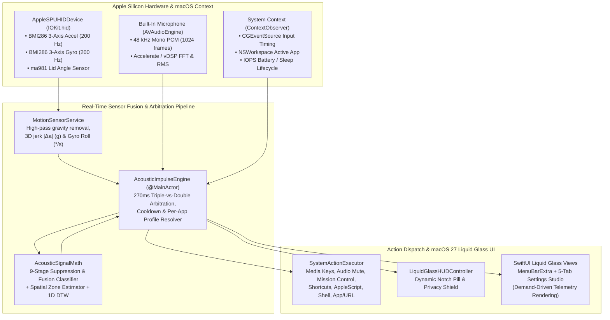

# ARCHITECTURE — KnockKnock X (Reson Sensor Fusion Engine)

---

## 1. High-Level System Architecture

---

## 2. Module Responsibilities

| Module | File Path | Responsibility |
| :--- | :--- | :--- |
| **Domain Models** | `Sources/KnockKnock/Models/GestureModels.swift` | Capability descriptors, gesture/action enums, rejection reasons, telemetry samples, and `AcousticClassifierConfig` validation/sanitization. |
| **Capability Registry** | `Sources/KnockKnock/Permissions/CapabilityRegistry.swift` | Live hardware (`sysctl`, `AppleSPUHIDDriver`) and permission (`AVCaptureDevice`, `AXIsProcessTrusted`) discovery with honest degradation states. |
| **SPU Motion Service** | `Sources/KnockKnock/Sensors/MotionSensorService.swift` | Direct user-space `IOHIDManager` driver waking the Bosch `BMI286` accelerometer & gyroscope at 200 Hz and reading the `ma981` lid angle sensor. |
| **Context Observer** | `Sources/KnockKnock/Sensors/ContextObserver.swift` | Monitors `CGEventSource` keyboard/mouse activity timing (without logging keys), trackpad/modifier hold state, frontmost app bundle ID, and sleep/battery events. |
| **Signal & Replay Math** | `Sources/KnockKnock/SignalProcessing/SignalFeatures.swift` | Pure, deterministic 9-stage impulse classification, gyroscope roll zone estimation, 1D Dynamic Time Warping (DTW), and `DeterministicReplayEngine`. |
| **Sensor Fusion Engine** | `Sources/KnockKnock/Engine/AcousticImpulseEngine.swift` | Coordinates `MotionSensorService` + `AVAudioEngine`, temporal cadence state machine, 4-knock calibration wizard, and demand-driven UI telemetry. |
| **Action Executor** | `Sources/KnockKnock/Services/SystemActionExecutor.swift` | Executes all 15 system/automation actions with timeout safety and structured execution summaries. |
| **Persistence Store** | `Sources/KnockKnock/Persistence/ConfigurationStore.swift` | Schema-versioned (`v2`) JSON persistence, corrupted payload recovery, and JSON profile import/export. |
| **Performance Monitor** | `Sources/KnockKnock/Diagnostics/PerformanceMonitor.swift` | Queries Mach kernel `task_info` (`MACH_TASK_BASIC_INFO` and `TASK_THREAD_TIMES_INFO`) for real resident memory (MB) and process CPU %. |
| **Liquid Glass UI** | `Sources/KnockKnock/UI/*` | Native macOS 27 `GlassEffectContainer`, `.glassEffect()`, `ControlCenterMenuBarView`, `SettingsWindowView`, and `LiquidGlassHUDController`. |

---

## 3. Swift 6 Concurrency & Real-Time Callback Isolation

A critical requirement on macOS 27 with Swift 6 strict concurrency is that **C and Objective-C real-time callbacks (`AVAudioNodeTapBlock` and `IOHIDReportCallback`) run on non-main real-time threads**.
- If a closure passed to `installTap(onBus:)` or `IOHIDDeviceRegisterInputReportCallback` is defined inside a `@MainActor`-isolated context, the Swift 6 compiler injects a hidden `_swift_task_checkIsolatedSwift` assertion that traps at runtime (`_dispatch_assert_queue_fail`).
- **Architectural Solution:**
  1. `AcousticImpulseEngine.makeAudioTapBlock(engine:sampleRate:)` is explicitly marked `nonisolated static` and performs all `vDSP` RMS, peak, crest factor, and 16-band spectral calculations on the real-time audio thread with zero heap allocations.
  2. `spuHIDInputReportCallback` is a free `nonisolated` C-convention function that delegates to `MotionProcessorState` (protected by `os_unfair_lock`) on the `IOHIDManager` run loop.
  3. Both callbacks hop to `@MainActor` **only** when either:
     - A physical mechanical impact ($\ge 0.015\,g$) or acoustic transient occurs, OR
     - At least one UI telemetry view (`ControlCenterMenuBarView` or `SettingsWindowView`) is currently open (`visibleTelemetryConsumers > 0`), throttled to $\le 12\,\text{Hz}$.
