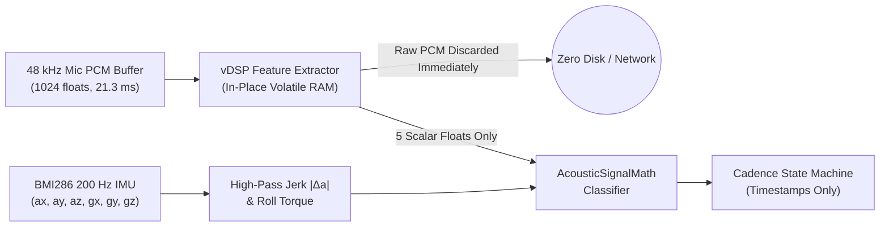

# SECURITY & PRIVACY — Local-Only Zero-Persistence Architecture

---

## 1. Core Privacy Guarantees

1. **Zero Audio Recording or Disk Persistence:**
   - KnockKnock X processes 1,024-sample ($21.3\,\text{ms}$) mono PCM buffers in volatile RAM using `Accelerate/vDSP` to extract 5 scalar features (`peak`, `rms`, `lowBandEnergy`, `midVocalEnergy`, `highBandEnergy`).
   - Raw PCM buffers are **immediately discarded** on the real-time audio callback thread. No audio waveform is ever written to disk, cached in memory, or transmitted anywhere.
2. **Accelerometer-Primary (Microphone-Off) Mode:**
   - Users who do not want the macOS microphone indicator active can switch to **Chassis Motion Only (`BMI286` 200 Hz)** mode in 1 click. In this mode, `AVAudioEngine` is completely stopped and closed, yet Double Knock, Triple Knock, Secret Rhythm, and Trackpad-Hold + Double Knock continue working via the physical accelerometer!
3. **Zero Keystroke Logging:**
   - Typing suppression uses `CGEventSource.secondsSinceLastEventType(.combinedSessionState, eventType: .keyDown)` which queries only the kernel timestamp elapsed since the last input event. It **never** installs a keylogger (`CGEventTap`) and **never** reads which key was pressed.
4. **Zero Network Telemetry:**
   - The application contains zero analytics SDKs, zero telemetry endpoints, and makes zero background network connections.

---

## 2. Sensor Data Flow Diagram

---

## 3. Automation & Shell Execution Safety Boundaries

- **Safe Default Mappings:** Destructive or intrusive actions (`Lock Screen`, `Shell Command`, `AppleScript`) are **never** mapped by default on first launch. Default mappings use safe media/HUD actions (`Play / Pause Media`, `HUD Preview Only`).
- **Explicit Shell Command Opt-In:** The `Run Shell Command` action is gated behind an explicit `enableShellAutomationOptIn` toggle in **Profiles & Automation** and executes with a hard $5.0\,\text{s}$ timeout so a hung user script cannot block the app.
- **Configuration Sanitization:** Imported JSON profiles pass through `ConfigurationStore.decodeAndValidate(data:)` and `AcousticClassifierConfig.validateAndSanitize()`, clamping all numeric thresholds to safe physical bounds before activation.
